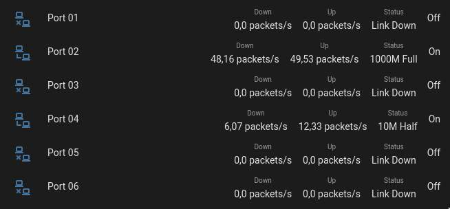

# TP-Link Easy Smart Switch integration for Home Assistant

This a _custom component_ for [Home Assistant](https://www.home-assistant.io/).
The `tplink_easysmartswitch` integration allows you to get port information from [TP-Link Easy Smart Switch](https://www.tp-link.com/fr/business-networking/easy-smart-switch/).

You will get two sensors by input enabled with all attributes availables, and a button to restart the switch.

## Installation

Copy the `custom_components/tplink_easysmartswitch` folder into the config folder.

## Configuration

Go to Configuration >> Integrations in the UI, click the button with + sign and from the list of integrations select TP-Link Easy Smart Switch.

## Web interface of the switch

The switch allows a single web session: logging in its web interface closes the session of Home Assistant, and the other way round.

When the session of Home Assistant is closed less than 5 minutes after it was last used, the integration takes it as a login in the web interface: it leaves the switch alone for 5 minutes, and its entities are unavailable meanwhile. Then it logs in again, which closes the session of the web interface if it is still open. Log in again in the web interface to get 5 more minutes.

When the session was unused for longer (scan interval of 5 minutes or more, or switch unreachable meanwhile), the integration considers it expired and logs in again right away.

## Lovelace Card example

With `multiple-entity-row` custom card:

```yaml
entities:
  - entities:
      - entity: sensor.port_01_ingress
        name: Down
      - entity: sensor.port_01_egress
        name: Up
      - attribute: link_status
        name: Status
    entity: binary_sensor.port_01
    type: custom:multiple-entity-row
type: entities

```



## Credits

https://github.com/psmode/essstat
